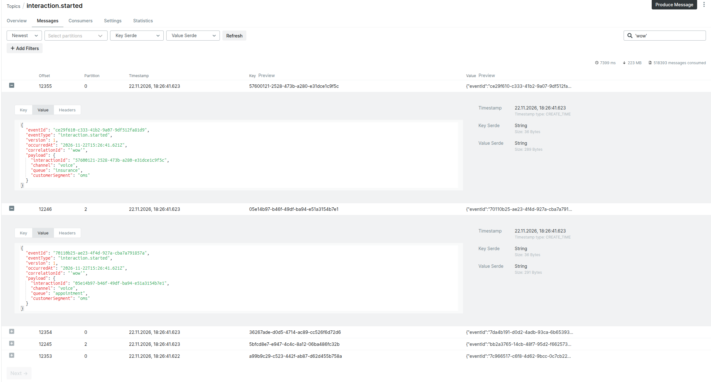

# Топики 

| имя | число партиций | число сообщений | retention | продюсер | консюмеры | источник |
|---|---|---|---|---|---|---|
| interaction.started (доменный топик) | 3 | 34598 (16:22 22.11.2026) | retention.ms: 604800000 (7 дней) | channel-simulator | `forecast-service`, realtime-gateway  (пример: `dashboard-gateway-nastya-Z370-HD3-3002`) | KafbatUI, klinpotok-wfm.docs.wfm-lite-spec.md |
| interaction.ended (доменный топик) | 3 | 34287 (16:23 22.11.2026) | retention.ms: 604800000 (7 дней) | channel-simulator | `forecast-service` | KafbatUI, klinpotok-wfm.docs.wfm-lite-spec.md |
| forecast-service.dlq (сервисный топик) | 3 | 0 | retention.ms:	1209600000 (14 дней) | forecast-service | человек, будущий replay-скрипт | KafbatUI, klinpotok-wfm.docs.wfm-lite-spec.md |
| __consumer_offsets (служебный топик) | 50 | N/A | retention.ms: 604800000 (7 дней) после того, как группа опустела | брокер-координатор | брокер-координатор | KafbatUI, официальная документация Kafka (AK 4.4.X / Implementation / Distribution) |

# Структура событий топиков

| Компонент | Назначение | Пример |
|---|---|---|
| Offset | Уникальный числовой идентификатор, который присваивается каждому сообщению внутри партиции топика | 11862 |
| Partition | Номер партиции в топике в которую было записано сообщение | 2 |
| Timestamp | Отметка времени, которая хранится в сообщении и указывает, когда это сообщение было создано или обработано | 22.11.2026, 17:24:11.727 |
| Key | Часть сообщения, которая помогает определить, в какую партицию топика его отправить. Берется из payload.interactionId в Value | b322347b-7a08-4114-b530-98981bcf8496 |
| Value | Полезная нагрузка сообщения | { &nbsp;&nbsp;"eventId": "96d5f7b3-c092-4ed0-a3ad-0420c17647d4", &nbsp;&nbsp;"eventType": "interaction.started", &nbsp;&nbsp;"version": 1, &nbsp;&nbsp;"occurredAt": "2026-11-22T14:24:11.727Z", &nbsp;&nbsp;"correlationId": "2620cef2-99a1-45d8-afc1-8bf5179ed5f5", &nbsp;&nbsp;"payload": { &nbsp;&nbsp;&nbsp;&nbsp;"interactionId": "b322347b-7a08-4114-b530-98981bcf8496", &nbsp;&nbsp;&nbsp;&nbsp;"channel": "voice", &nbsp;&nbsp;&nbsp;&nbsp;"queue": "appointment", &nbsp;&nbsp;&nbsp;&nbsp;"customerSegment": "dms" &nbsp;&nbsp;} } |
| Headers | Произвольные key-value пары, которые можно прикрепить к сообщению | { &nbsp;&nbsp;"event-type": "interaction.started", &nbsp;&nbsp;"x-correlation-id": "2620cef2-99a1-45d8-afc1-8bf5179ed5f5", &nbsp;&nbsp;"event-version": "1" } |

# Назначение полей в Headers событий доменных топиков

| Поле | Назначение | Пример |
|---|---|---|
| "event-type" | Для определения типа события | "interaction.started" |
| "x-correlation-id" | Сквозная трассировка нужна чтобы логировать и маршрутизировать, не парся Value | "2620cef2-99a1-45d8-afc1-8bf5179ed5f5" |
| "event-version" | Версия схемы нужна для эволюции контракта: когда payload изменится, потребитель сможет понять, с какой версией имеет дело | "1" |

# Назначение полей в Value событий доменных топиков

| Поле | Назначение | Пример | Для какого типа события |
|---|---|---|---|
| "eventId" | Уникальный id события. Ключ дедупликации: повтор с тем же eventId не меняет состояние | "96d5f7b3-c092-4ed0-a3ad-0420c17647d4" | interaction.ended, interaction.started |
| "eventType" | Что случилось; совпадает с именем топика: interaction.started или interaction.ended | "interaction.started" | interaction.ended, interaction.started |
| "version" | Версия схемы payload; при изменении схемы повышается | 1 | interaction.ended, interaction.started |
| "occurredAt" | Время в домене — когда произошло, а не когда записали в Kafka | "2026-11-22T14:24:11.727Z" | interaction.ended, interaction.started |
| "correlationId" | Сквозной id бизнес-цепочки; дублируется в заголовок x-correlation-id | "2620cef2-99a1-45d8-afc1-8bf5179ed5f5" | interaction.ended, interaction.started |
| "payload" | Объект, содержит данные события |  &nbsp;&nbsp;"payload": { &nbsp;&nbsp;&nbsp;&nbsp;"interactionId": "b322347b-7a08-4114-b530-98981bcf8496", &nbsp;&nbsp;&nbsp;&nbsp;"channel": "voice", &nbsp;&nbsp;&nbsp;&nbsp;"queue": "appointment", &nbsp;&nbsp;&nbsp;&nbsp;"customerSegment": "dms" &nbsp;&nbsp;}  | interaction.ended, interaction.started |
| "interactionId" | id обращения (чата/звонка). Он же ключ партиции | "b322347b-7a08-4114-b530-98981bcf8496" | interaction.ended, interaction.started |
| "outcome" | resolved — обработано оператором; abandoned — клиент ушёл, не дождавшись | "resolved" | interaction.ended |
| "channel" | Канал обращения: chat или voice | "voice" | interaction.started |
| "queue" | Очередь обращения. По конвенции — appointment, lab-results, home-visit, insurance, general | "appointment" | interaction.started |
| "customerSegment" | Сегмент клиента: платно, ДМС, ОМС | "dms" | interaction.started |

При отправке запроса http://localhost:3001/simulator/burst?count=5 с заголовком  x-correlation-id: 'wow' 5 запросов отправились в разные партиции (скрин 1). То в какую партицию попадет сообщение определяется ключом партиции, а он определяется interactionId. correlationId - определяет одну бизнес-цепочку, а не одно событие.

# 1. Результат создания 5 событий с заголовком 'wow'

# Вопросы и ответы

1. Гарантирован ли порядок `started` → `ended` для одного обращения? Почему?

Не гарантирован, события начала и конца обращения пишутся в разные топики, kafka гарантирует сохранение последовательности только внутри одной партиции одного топика.

2. Почему у одного события ключ — `interactionId`?

Это позволяет помещать события в одинаковые номера партиций разных топиков. Также облегчает поиск по обращению.

3. Чем отличаются две consumer group и зачем им разная логика?

forecast-service делит работу, gateway дублирует поток на каждый экземпляр. Одна группа здесь была бы багом для одной из задач.

